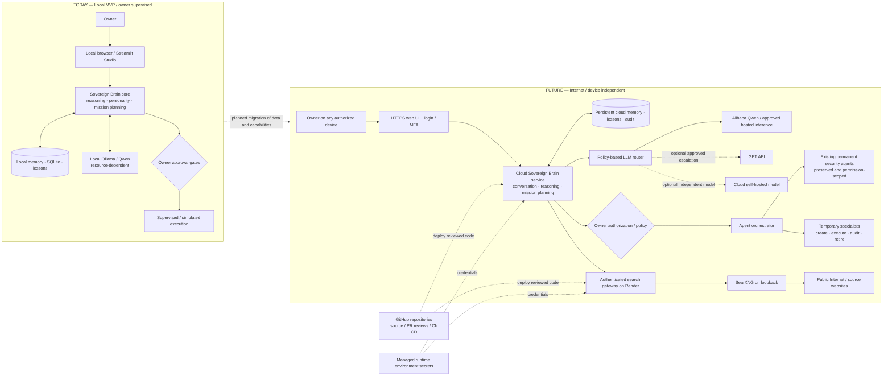

# Sovereign Brain — Architecture Baseline & Internet Operating Vision (v1)

> **Status:** Vision / design baseline, not a claim of production readiness.  
> **Baseline date:** 2026-11-23  
> **Canonical project:** `security-company-agent` in `AFLplusplus`.  
> **Related deployment component:** [sovereign-brain-search](https://github.com/budhadityarishidasgupta-lang/sovereign-brain-search) (separate repository).

## 1. North-star outcome

Sovereign Brain becomes a **device-independent, securely authenticated, cloud-hosted intelligence and orchestration system**. Its owner can sign in through a browser on an authorized device while the application, persistent identity/memory and approved agents continue operating on hosted infrastructure rather than relying on the owner's Windows laptop being online.

The MVP remains **local-first and owner-supervised**. Production expansion must preserve the current Brain identity, personality, memory, lessons, security agents, permission boundaries and audit history. No silent migration or deletion of the existing system is permitted.

## 2. Architecture — current MVP and future state

**Diagram interpretation:** arrows express intended integrations, not proof that a capability is live. The hosted search gateway is its **own service**, not proof the Brain is hosted. Cloud inference must be available when the laptop is off; a laptop-only Ollama model cannot satisfy the system-independent objective.

## 3. Responsibilities and ownership

| Component | Current position | Target responsibility |
| --- | --- | --- |
| Owner UI | Local Streamlit Studio | Browser-accessible cloud UI with secure owner login and MFA |
| Sovereign Brain | Local cognition / personality / learning | Hosted Brain API/runtime with durable identity and conversation state |
| Memory and lessons | Local persistence | Backed-up, access-controlled persistent cloud database and encrypted object storage as needed |
| Model execution | Local Ollama/Qwen plus configured cloud providers | Policy router to approved hosted/self-hosted inference; avoid mandatory dependence on a single model vendor |
| Search | Standalone Render SearXNG gateway under validation | Protected, observable, owner-authorized web research service |
| Agent orchestration | Existing permanent security agents, supervised/simulated workflows | Preserve permanent agents; provision bounded temporary specialists from approved templates |
| GitHub | Source and branching, PRs and checks | Source of truth for code, architecture docs, CI/CD and controlled releases; **not** the runtime secrets vault |
| Secrets | Ignored local `.env` for MVP; Render environment settings for hosted search | Hosted environment secrets or managed secret service, narrow per-agent scopes and rotation |
| Audit & approvals | Owner-supervised actions and execution records | Durable approvals, execution ledger, idempotency and fail-closed recovery |

## 4. Security and operational invariants

1. **Explicit owner approval** for sensitive actions, external research when required by policy, high-cost model escalation and agent execution.
2. **Permanent security agents are never deleted** as part of migration or temporary-agent cleanup; preserve source, identities, permissions and state.
3. **Temporary specialist agents are bounded**: approved templates, scoped tokens, isolated runtime, time/budget limits, audit and retirement.
4. **Search separation**: public HTTPS reaches only the bearer-authenticated gateway; SearXNG listens on loopback. A health endpoint discloses no secrets.
5. **No secrets in Git**: local `.env` is ignored; Render/hosted environment manages runtime secrets. GitHub Actions secrets are only for workflows and are not a live application secret store.
6. **Least privilege and recovery**: default deny, no arbitrary unreviewed LLM-generated code deployment, exactly-once/idempotent external effects where applicable, audit logs and recoverable shutdown.
7. **Production durability**: migration is validated with backups, restore tests, data integrity checks and rollback plans. The laptop remains untouched until cloud acceptance.
8. **No silent infrastructure spend**: retain existing Free Render search service for validation; production capacity/availability requires explicit owner review.

## 5. Release / migration roadmap

| Stage | Deliverable | Exit gate |
| --- | --- | --- |
| A — Local MVP | Stable personality, memory, supervised reasoning and existing permanent agents | Local tests, owner review, integrity of existing data |
| B — Hosted search | Render protected SearXNG gateway connected to Brain | Render deploy **Live**, `/healthz` 200, anonymous `/search` 401, authenticated JSON search, isolated upstream, safe logging |
| C — Cloud Brain | Hosted app with secure login, approved hosted inference and persistent cloud state | Login/MFA, end-to-end browser operation with laptop **off**, backups/restores, privacy review |
| D — Cloud orchestrator | Existing permanent security agents migrated/preserved, safe temporary specialists | Agent inventory reconciled, scoped credentials, approval gates, isolation, audit and retirement tests |
| E — Production hardening | Observability, reliability, recovery, quotas and operational runbooks | Security assessment, SLOs, cost approval, incident drill and sign-off |

## 6. Current implementation notes (as of baseline)

- The local Brain is the working MVP. Local environment setting `SEARXNG_APPROVED=0` is the intended safe state until hosted search passes live verification; do not enable research solely because CI passes.
- The dedicated `sovereign-brain-search` GitHub repository has a separate Render service and its own release process. Passing a GitHub Actions container smoke test does **not** imply Render is Live.
- The device-independent cloud Brain, cloud database migration and dynamic temporary-agent execution shown above are **future-state design**, not completed deployments.
- The cloud model route is policy-based, not a promise of automatic silent GPT escalation. Owner consent and provider availability govern any fallback.

## 7. Change governance

This is **Architecture Baseline v1**. Future deviations should be proposed in separate design decisions (ADRs), cross-linked to implementation PRs and reviewed before the baseline is amended. Keep architecture updates in documentation-only pull requests; do not combine them with security-agent deletions or production deployment changes.

**Initial adoption:** merge this document into the Sovereign Brain project branch after owner review. This document is a design reference, not executable configuration.
